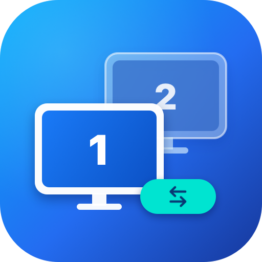

  

# UU远控切屏

UU 远程 iOS 客户端快捷切屏插件，支持 iOS 15.0 及以上。将默认控制菜单里的展开全部窗口和显示桌面替换为直接切换显示器，适合双显示器用户。

## 功能

- 将远控底部默认控制栏中的「展开所有窗口」替换为「显示器1」。
- 将远控底部默认控制栏中的「显示桌面」替换为「显示器2」。
- 在底部栏点击即可直接切换对应显示器，无需进入多层菜单。
- 当前显示器对应的文字和图标显示为蓝色高亮状态。
- 记住各显示器的缩放比例与平移定位，在切换显示器以及 App 切到后台返回后自动恢复视角。

## 安装

正式版本：**1.0.2**。包名：`im.mjh.uuscreenswitch`（RootHide 为 `im.mjh.uuscreenswitch.roothide`）。

| 环境 | 下载 |
|---|---|
| Rootless | [UUScreenSwitch_1.0.2_arm64.deb](https://github.com/5hux1n/UUScreenSwitch/releases/download/v1.0.2/UUScreenSwitch_1.0.2_arm64.deb) |
| RootHide | [UUScreenSwitch_1.0.2_arm64e.deb](https://github.com/5hux1n/UUScreenSwitch/releases/download/v1.0.2/UUScreenSwitch_1.0.2_arm64e.deb) |

可通过个人插件源 [apt.mjh.im](https://apt.mjh.im/) 直接添加安装。

## 更新日志

### 1.0.2
- 新增各显示器视角记忆与定位修复：切换显示器时自动记住缩放和偏移，切回时精准恢复，支持应用进入后台返回后恢复视角。

### 1.0.1
- 新增当前显示器高亮状态，当前显示器的文字和图标显示为蓝色。

### 1.0.0
- 首次发布：将远控底部控制栏的「展开所有窗口」和「显示桌面」替换为「显示器1」和「显示器2」，点击直接切换显示器。

## 关于与支持

- 作者：[Junhong](https://mjh.im/)
- 插件源：[apt.mjh.im](https://apt.mjh.im/)
- 反馈：[https://pingme.pm/uuscreenswitch](https://pingme.pm/uuscreenswitch)
- GitHub：[https://github.com/5hux1n/UUScreenSwitch](https://github.com/5hux1n/UUScreenSwitch)
